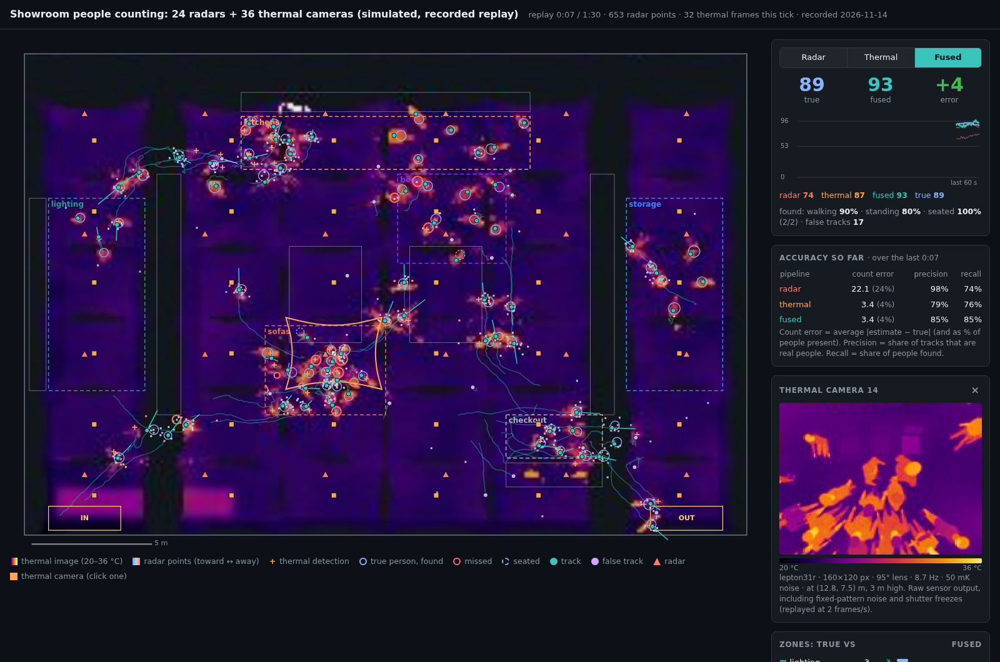

# Multi-sensor people counting: mmWave radar + thermal cameras

Simulator and baseline pipelines for counting and locating people in large spaces (showrooms,
studios) with ceiling-mounted TI IWR6843AOP radars and FLIR Lepton thermal cameras, and for
producing engagement analytics (people per zone over time, dwell heatmaps).

**Live page: [pratik-ingle.github.io/Multi-sensor-people-counting](https://pratik-ingle.github.io/Multi-sensor-people-counting/)**
replays a recorded 90 s run of the simulator in the browser: thermal image of the floor, radar
points, true people, radar / thermal / fused tracks, running accuracy, and raw output of any
thermal camera (click one). GitHub Pages only hosts static files, so this is a recording; the
fully live, interactive version runs locally (see [Live viewer](#live-viewer)).

[](https://pratik-ingle.github.io/Multi-sensor-people-counting/)

## Quick start

```bash
python3 -m venv .venv && .venv/bin/pip install -r requirements.txt
.venv/bin/python scripts/simulate.py --config configs/showroom.yaml --out data/sim_run1   # ~4 min for 5 min
.venv/bin/python scripts/run_baseline.py --run data/sim_run1                             # ~2 min
```

Thermal rendering needs an OpenGL 3.3 GPU; it runs headless through EGL (no display needed).
Set `thermal.enabled: false` in the config to simulate radar only.

### Live viewer

```bash
.venv/bin/python scripts/live_server.py      # open http://localhost:8780
```

Runs the simulation and all three trackers in real time and streams them to a browser page:
radar points, a stitched thermal image of the floor, thermal detections, true people (red ring
= missed), tracks, and live total and per-zone counts. Switch between Radar / Thermal / Fused,
click any thermal camera to watch its raw output, and change the crowd size or the radar's
still-person processing while it runs. Over VS Code Remote-SSH the port is forwarded
automatically; if not, add 8780 in the PORTS panel.

### Updating the live page

```bash
.venv/bin/python scripts/export_replay.py --seconds 90 --out docs   # ~2 min, ~33 MB
```

Records the simulator into `docs/replay/` (frames in chunks, thermal floor images and raw camera
frames as JPEG sprite sheets) and copies `web/live.html` to `docs/index.html`. The page detects
the recording next to it and switches from the live stream to playback. GitHub Pages serves the
`docs/` folder of `main`.

### Batch outputs

`data/sim_run1/baseline/`, one set per pipeline `<p>` = radar / thermal / fused:

| File | Content |
|---|---|
| `tracks_<p>.csv` | every frame: track id, x, y, vx, vy, zone (where each person is) |
| `counts_<p>.csv` | every frame: total count and count per zone |
| `zone_summary_<p>.csv` | average occupancy and share of time per zone |
| `metrics.json` | accuracy of each pipeline vs. simulation ground truth |
| `*.png` | coverage map, snapshot, counts over time, heatmaps, zone shares, raw thermal frames |

## Results on the simulated showroom (5 min, ~98 people, 24 radars + 36 Lepton 3.1R)

| | radar | thermal | fused |
|---|---|---|---|
| average count (true 97.6) | 70.6 | 93.8 | 95.0 |
| count error, mean abs (people) | 27.0 | 5.7 | 6.0 |
| precision / recall | 0.97 / 0.70 | 0.80 / 0.77 | 0.85 / 0.83 |
| position error | 0.14 m | 0.26 m | 0.17 m |
| found: walking / standing / seated | 0.88 / 0.62 / 0.34 | 0.77 / 0.77 / 0.74 | 0.91 / 0.79 / 0.67 |

Tracker settings are tuned per pipeline (`PIPELINE_TUNING` in `mmw/tracker.py`): radar holds
tracks of still people for 20 s because static clutter removal hides them; thermal and fused
hold them 5 s and need 3 detections in 5 frames to start a track. With the radar settings,
thermal over-counted by 22 people.

## Data format

| File | Content |
|---|---|
| `points.npy` | radar: one row per point, `frame, sensor, range, azimuth, elevation, doppler, snr` (TI compressed point-cloud TLV) |
| `thermal_dets.npy` | thermal: per-camera edge detections, `frame, cam, x, y, strength, nadir_dist` |
| `thermal_captures.npy` | every camera capture `frame, cam` (cameras free-run at ~8.7 Hz, unsynchronised) |
| `thermal_frames.npy` | raw frames, uint16 centi-kelvin `[snapshot, camera, row, col]` (Lepton TLinear), 1 Hz |
| `gt.npy` | simulation truth: `frame, pid, gid, x, y, vx, vy, browsing, height, seated` |
| `meta.json` | config, sensor poses (true and calibrated), thermal camera model |

A logger for real sensors only has to write the same files and the pipeline runs unchanged.

## How the thermal simulation works

| Stage | Module | What is modelled |
|---|---|---|
| Scene | `mmw/meshes.py`, `mmw/thermal_scene.py` | articulated 3D people (15 parts, walking gait, standing, reaching, sitting); shelving with goods, sofas, beds, kitchen with steel appliances, lamps switched on, checkout monitors; storefront glass, sunlit floor, HVAC drift; warm imprints left on seats |
| People | `mmw/crowd.py` | skin temperature plus clothing / hair insulation per person (t-shirt to jacket, short / long hair, hats, shorts / skirts) |
| Physics | `mmw/radiometry.py` | 8-14 um band radiance (Planck), emissivity + reflected surroundings, mixing inside pixels done in radiance |
| Optics | `mmw/thermal_render.py` | GPU rasterisation, then each pixel integrated over the real distorted lens rays with footprint and blur |
| Sensor | `mmw/thermal_camera.py` | Lepton 3.1R / 3.5 or MLX90640 presets: NETD noise, fixed-pattern noise and its drift, column noise, per-unit offset and gain error, vignetting, shutter (FFC) freezes, chess-pattern readout (MLX), 0.01 K quantisation |
| Detection | `mmw/thermal_detect.py` | per-camera background model (empty-store reference, selective update), warm-blob peaks, projection to the floor, merging across overlapping cameras along each camera's radial error direction |

## Code map (radar)

| Module | Role |
|---|---|
| `mmw/layout.py` | floor plan, furniture, zones, seats, walking navigation |
| `mmw/body.py` | body as ~40 scatterers with gait micro-Doppler (seated poses folded) |
| `mmw/radar.py` | IWR6843AOP point-cloud model (FoV, SNR, static clutter removal, occlusion, resolution merging, multipath ghosts, false alarms) |
| `mmw/fusion.py` | all radars into store coordinates, drop impossible points |
| `mmw/tracker.py` | centralised gtrack-style tracker with static retention (shared by all pipelines) |

## Calibrating against real hardware

Radar and thermal parameters in `configs/showroom.yaml` and `mmw/thermal_camera.py` are
approximations. Record a real AOP and a real Lepton for a few minutes (one person walking,
standing, sitting; two people side by side) and tune until points-per-person, SNR, blob
temperatures and noise match before trusting simulated training data.
